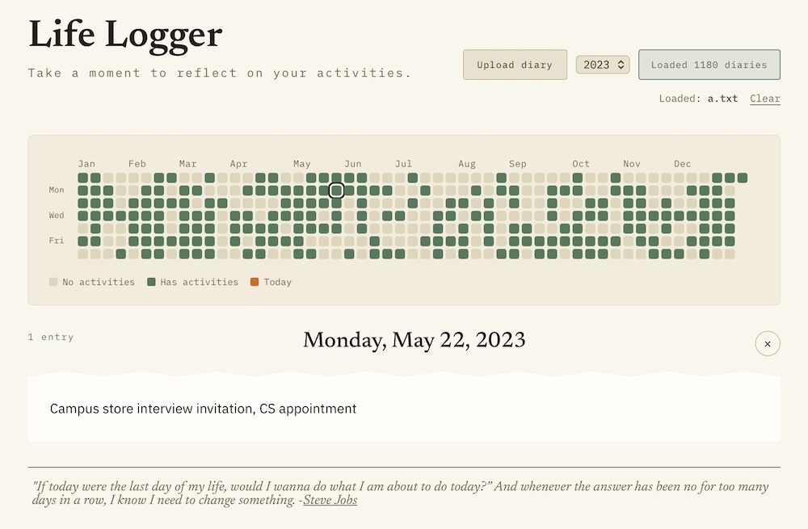

# Life Logger



A diary activity visualizer with a GitHub Contribution-style calendar.

Upload a plain text diary and get a quick overview of your yearly activities. Click on a day that has activity to read what you wrote for that day.

Everything runs client-side in the browser.

## Run Locally

```bash
npm install
npm run dev
```

Then go to http://localhost:3000.

## How to Write the Diary

The diary should be formatted in the following convention:

- One entry per line.

- Each line should follow this format: `M-D-YYYY: content`, that is:
    - Month, then day, then a 4-digit year (matching the example where `1-23-2026` means January 23, 2026).
    - Month/day can be one or two digits.

- Everything after the first `:` is the diary's content.

- Multiple lines can share the same date. They're grouped and all shown together when clicked on that day.

For example:

```
8-22-2026: what I did on this day
8-21-2026: some event description here
8-20-2026: another event
```

## Technical Details

**Frameworks Used:** Next.js, React

**Build System:** Next.js built-in (SWC)

**License:** [GNU General Public License v3.0](LICENSE)